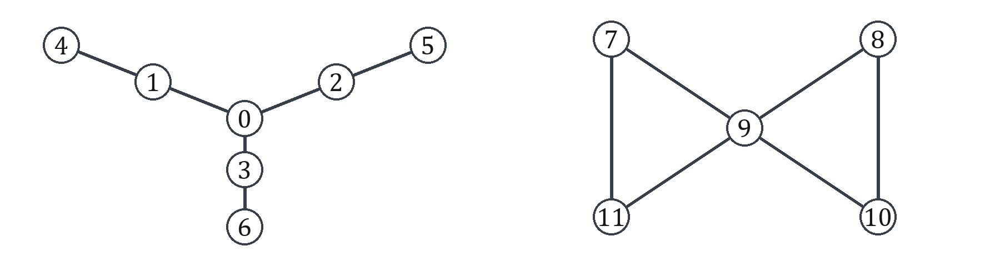

# Sharp bounds for typed triangle absorbers of doubled ears

Juan Pablo Traverso Gianini  
Independent researcher, Santiago, Chile  
ORCID 0009-0003-6068-4096

*Triangle decompositions · Research note accompanying Paper II*  
*Preprint 1.0 · 25 November 2026*  
DOI [10.5281/zenodo.24555328](https://doi.org/10.5281/zenodo.24555328)

## Abstract

We study the graph formed by attaching two ears to each edge of a simple core graph. Each ear joins the endpoints of its core edge by a path of length two. The union of these paths is the graph to be absorbed, and the core edges remain available in the host. When each triangle in a decomposition must meet both parts of a vertex bipartition, every absorber has at least six edges per core edge. We characterize equality by an assignment of auxiliary vertices to core edges, permutations of the incident assignments at each core vertex, and a mixed triangle decomposition of the resulting auxiliary graph. Two labellings of the same three-edge path have minimum absorber sizes 18 and 21. A subdivided claw attains 36, and gluing copies at the centre gives an infinite family attaining the bound whose core edges cannot be partitioned into connected triples. If the absorber may use no edges between core vertices, the lower bound rises to twelve edges per core edge.

## 1. Setting

Write $C$ for the edge set of a simple graph on central vertices and $m=|C|$. For every $e=uv\in C$, introduce two new vertices, the ears of $e$. Each ear is adjacent to $u$ and $v$. Let $P$ be the set of all four edges per core edge joining a centre to an ear. We call $P$ the source. Thus $|P|=4m$. The host $H$ induces exactly $C\cup P$ on the centres and ears. All other vertices are auxiliary, and edges involving auxiliaries may be arbitrary. A labelling $p\colon V(H)\to\{0,1\}$ defines a *mixed* triangle as one with both labels.

An absorber is an edge set $A\subseteq E(H)\setminus P$ such that both $A$ and $A\cup P$ admit mixed triangle decompositions. Call these the negative and positive modes respectively. The two decompositions allow the same set of reserve edges to absorb $P$ or to be decomposed on its own [1]. We use the family of mixed triangle types from Paper II [2]. We give a lower bound for the number of reserve edges and characterize when six reserve edges per core edge suffice. Appendix A records the Lean statements used here.

## 2. The lower bound and its equality case

**Theorem 1.** Every absorber satisfies

$$
|A|\ge 12m-6|A\cap C|\ge 6m.
$$

An absorber of size $6m$ exists if and only if the following choices are possible in $H$.

1. For each $e=uv\in C$, choose an auxiliary vertex $c_e$ such that $uvc_e$ is a mixed triangle. At each central vertex $u$, the vertices $c_e$ for $e\ni u$ are pairwise distinct.
2. At each central vertex $u$, permute those auxiliary vertices among the edges incident with $u$. Write $x_{u,e}$ for the vertex assigned to $e$ by this permutation.
3. For each $e=uv$, designate one ear $a_e$ as the *intact ear* and the other $b_e$ as the *split ear* so that $uva_e$, $ub_ex_{u,e}$, $vb_ex_{v,e}$ and $b_ex_{u,e}x_{v,e}$ are mixed triangles of $H$.
4. The pairs $x_{u,e}x_{v,e}$, indexed by $e=uv\in C$, are distinct and their edge set has a mixed triangle decomposition.

*Proof.* Assign charges to edges according to their endpoint roles. We use $s=1$ for the bound and $s=2$ to identify the equality case.

| Endpoint roles | Positive mode | Negative mode |
|:--|--:|--:|
| Centre and ear | $7s+1$ | $0$ |
| Two centres | $-8s-2$ | $-2$ |
| Centre and auxiliary | $-1$ | $1$ |
| Ear and auxiliary | $-s$ | $s$ |
| Two auxiliaries | $2s$ | $-2s$ |

Write $\mathsf C,\mathsf E,\mathsf X$ for the three vertex roles. No two ears are adjacent. In the negative mode a centre and an ear cannot be adjacent either, since every such edge belongs to $P$. Summing the three edge charges gives the following table. A dash means that the type cannot occur.

| Triangle roles | Positive charge | Negative charge |
|:--|--:|--:|
| $\mathsf{CCC}$ | $-24s-6$ | $-6$ |
| $\mathsf{CCE}$ | $6s$ | — |
| $\mathsf{CCX}$ | $-8s-4$ | $0$ |
| $\mathsf{CEX}$ | $6s$ | — |
| $\mathsf{CXX}$ | $2s-2$ | $2-2s$ |
| $\mathsf{EXX}$ | $0$ | $0$ |
| $\mathsf{XXX}$ | $6s$ | $-6s$ |

For instance, a positive $\mathsf{CCE}$ triangle has one core edge and two source edges, with total charge $(-8s-2)+2(7s+1)=6s$. For both choices of $s$, the table bounds the positive charge of each triangle by $6s$ and the negative charge by zero. The triangles of a decomposition partition its edges into triples. Thus the positive mode contributes at most $6s(|A|+|P|)/3$, and the negative mode contributes at most zero. Adding the charges on the common edge set cancels all terms except those on the core edges. Including the source charge gives

$$
2s(|A|+|P|)\ge (7s+1)|P|-(8s+4)|A\cap C|.
$$

At $s=1$ this reads $2|A|\ge 6|P|-12|A\cap C|$. Substituting $|P|=4m$ and using $|A\cap C|\le m$ gives both inequalities of the theorem.

For $|A|=6m$, the bound forces all core edges into $A$. At $s=2$ both sides of the charge inequality equal $40m$. A single triangle below its maximum would give a strict inequality after summation. Hence every positive triangle has charge 12 and every negative triangle has charge zero. Every core edge therefore lies in a negative $\mathsf{CCX}$ triangle, defining $c_e$. At a fixed centre, two such triangles with the same auxiliary vertex would share an edge. The positive mode uses each core edge in one $\mathsf{CCE}$ triangle, whose ear must belong to that edge, since an ear has only its two prescribed central neighbours. This is the intact ear $a_e$. The two source edges of the split ear $b_e$ cannot use that core edge a second time, so they occur in $\mathsf{CEX}$ triangles. At each centre, the auxiliary neighbours arising in these triangles are distinct and form the same set as those in the negative mode, since they are the neighbours in the common edge set $A$. This gives the local permutation.

At $b_e$ the positive mode supplies exactly two edges to auxiliaries, one for each endpoint of $e$. Their auxiliary endpoints are distinct, since otherwise the two triangles would share an edge. Both edges lie in $A$. The only tight negative type containing an ear is $\mathsf{EXX}$, so the negative decomposition must pair them in the triangle $b_ex_{u,e}x_{v,e}$. Different split ears give different auxiliary edges because negative triangles are edge-disjoint. Conversely, every auxiliary edge in the negative mode belongs to such a triangle, and every auxiliary edge in the positive mode belongs to a triangle of type $\mathsf{XXX}$. This proves condition 4.

Conversely, take $A$ to consist of the core edges, the $2m$ edges from centres to their assigned auxiliaries, the $2m$ edges from split ears to auxiliaries, and the $m$ auxiliary edges of condition 4. The four classes are disjoint. The $uvc_e$ and $b_ex_{u,e}x_{v,e}$ triangles partition $A$. In the positive mode, use $uva_e$, $ub_ex_{u,e}$, $vb_ex_{v,e}$ and the decomposition of condition 4. The local permutations ensure these triangles use exactly the same edges between centres and auxiliaries as the negative mode. The rest of their edges cover $P$ and the other classes of $A$ exactly once. $\square$

Equality implies $3\mid m$, because its auxiliary graph has $m$ edges and decomposes into triangles. When the centres belong to a protected set $Z$ and $A$ has no edge with both ends in $Z$, all core edges are forbidden in $A$, so $|A|\ge12m$.

## 3. Same core, different minima

For each finite example, the host consists of the core and source edges together with all simple edges incident with an auxiliary vertex.

In the first labelling, the path $0,1,2,3$ has centre labels $1,0,0,1$. The auxiliary vertices $4,5,6$ have labels $0,1,0$. The two ears on $01$ both have label zero, those on $12$ have label one, and those on $23$ have label zero. Each row gives $c_e$ and the ordered pair of auxiliaries at the endpoints of the split ear.

| Core edge | $c_e$ | $(x_{u,e},x_{v,e})$ |
|:--|--:|:--|
| $01$ | 4 | $(4,5)$ |
| $12$ | 5 | $(4,6)$ |
| $23$ | 6 | $(5,6)$ |

At centre $1$, the assignments $4,5$ on $01,12$ appear in the reverse order in the two split ears. The same interchange occurs at centre $2$ with $5,6$, while each leaf keeps its sole assignment. The auxiliary pairs are precisely the three edges of the mixed triangle $456$. Substitution of the labels in each row verifies condition 3. The minimum is 18. To use the same unlabelled host as in the next example, add a fourth auxiliary vertex of either label. The bound and the 18-edge construction still apply.

In the second labelling the centres have labels $0,0,1,0$. The ears on $01$ and $12$ all have label one, and those on $23$ have label zero. Suppose there is an 18-edge absorber and let $w=c_{23}$. At the leaf $3$, the sole edge to an auxiliary goes to $w$. The positive triangle on this edge uses the split ear on $23$. Since leaf $3$ and that ear both have label zero, the mixed-triangle condition forces $p(w)=1$. At vertex $2$, the positive triangle on its edge to $w$ cannot use that same ear, since this would repeat the edge from the ear to $w$. It must use the split ear on $12$. That ear and vertex $2$ both have label one, forcing $p(w)=0$. This excludes 18. Since $A$ decomposes into triangles, it must have at least 21 edges.

To attain 21, number the two ears of $01,12,23$ by $(4,5),(6,7),(8,9)$, respectively. The auxiliary vertices $10,11,12,13$ have labels $0,0,1,1$. The negative mode consists of the mixed triples

$$
(0,1,12), (1,2,10), (2,3,11), (3,12,13), (5,10,12), (7,11,12), (9,10,13).
$$

These seven triples have disjoint edge sets, giving a set $A$ of 21 edges disjoint from $P$. For the positive mode we use

$$
\begin{gathered}
(0,1,4), (0,5,12), (1,2,6), (1,5,10), (1,7,12), (2,3,8),\\
(2,7,11), (2,9,10), (3,9,13), (3,11,12), (10,12,13).
\end{gathered}
$$

The ear pairs $(4,5),(6,7),(8,9)$ account for all twelve source edges. For example, the triple $(0,1,4)$ covers both source edges at ear $4$, whereas $(0,5,12)$ and $(1,5,10)$ cover the two at ear $5$ separately. In the list, each remaining edge belongs to $A$ and no pair is repeated. The eleven triples thus cover $33=21+12$ edges, as required.

## 4. An acyclic core family attaining the bound

The next core is obtained by subdividing each edge of a claw once. Its centre is $0$, its intermediate vertices are $1,2,3$, and its leaves are $4,5,6$. In this order the seven vertices have labels $0,0,0,1,1,1,0$. The auxiliary vertices $7,8,9,10,11$ have labels $1,1,0,0,0$. Figure 1 shows the two graphs whose edges index the first and third columns of the table.

{width=82%}

| Core edge | $c_e$ | $(x_{u,e},x_{v,e})$ | $p(a_e)$ | $p(b_e)$ |
|:--|--:|:--|--:|--:|
| $01$ | 7 | $(8,9)$ | 1 | 1 |
| $14$ | 9 | $(7,9)$ | 1 | 0 |
| $02$ | 8 | $(9,10)$ | 1 | 1 |
| $25$ | 10 | $(8,10)$ | 1 | 0 |
| $03$ | 9 | $(7,11)$ | 1 | 0 |
| $36$ | 11 | $(9,11)$ | 0 | 1 |

The auxiliary edges decompose into the mixed triangles $7,9,11$ and $8,9,10$, which share just vertex $9$. For example, at centre $0$ the assignments $7,8,9$ reappear as $8,9,7$. At vertex $1$ the assignments $7,9$ are interchanged, as are the two assignments at each of $2$ and $3$. Each leaf keeps its assignment. The last two columns give mixed triangles in all six rows. Theorem 1 therefore gives a minimum of $6\cdot6=36$.

For any $k\ge1$, take $k$ copies of this construction and identify their centres $0$, using fresh ears and auxiliaries in each copy. The triangle decompositions from different copies have disjoint edge sets in each mode and agree on the shared label. Their union gives an absorber of size $36k$, attaining the lower bound for the subdivided star with $3k$ branches. The core edges admit no partition into connected triples. Each outer edge touches only its own inner edge in the line graph, so a connected triple contains at most one outer edge. A partition of the $6k$ edges would consist of $2k$ triples and could cover at most $2k$ outer edges, fewer than the $3k$ outer edges present for every $k\ge1$.

## Acknowledgments

The author is deeply grateful to his wife María Paz and his children Lucas, Juan Cristóbal, Francisca, Raimundo and Benjamín for their love, patience and support. He thanks the Lean and Mathlib communities for the infrastructure used in the formalization.

## Use of artificial intelligence and computational tools

ChatGPT/Codex, by OpenAI, was used to explore and check arguments, develop the Lean proofs and prepare the manuscript and figure. Computations checked the finite constructions. The proof of the universal lower bound is given in Section 2. The author remains responsible for the arguments, citations, code and presentation. No AI system is listed as an author.

## References

[1] B. Barber, S. Glock, D. Kühn, A. Lo, R. Montgomery and D. Osthus, *Minimalist designs*, Random Structures & Algorithms **57** (2020), 47–63. <https://arxiv.org/abs/1808.06956>.

[2] J. P. Traverso Gianini, *Triangle decompositions II: Robust absorption for typed triangles*, preprint 1.0 (2026). <https://doi.org/10.5281/zenodo.23502224>.

## Appendix A. Lean formalization

The formalization uses the predicate `IsAbsorber` of Paper II. It requires disjointness of $A$ and $P$ and mixed triangle decompositions of $A$ and $A\cup P$. The partition into two labels and the partition into three vertex roles are independent. In the table, declaration names are relative to `PartitionedTriangleAbsorption.SignedCertificate`.

| Namespace | Declaration | Conclusion |
|:--|:--|:--|
| DoubledEarEquality | `core_sensitive_bound` | Lower bound in Theorem 1 |
| DoubledEarEquality | `protected_centres_bound` | Lower bound with protected centres |
| DoubledEarEquality | `optimum_iff_routing_modes` | Equality in incidence form |
| DoubledEarEquality | `twoMode_of_routing_modes` | Transfer to the two-mode interface |
| TriangleFreeCore | `minimum_path_absorber` | Minimum 18 |
| LabelledPathMinimum | `minimum_labelled_path_absorber` | Minimum 21 |
| SubdividedClawMinimum | `minimum_subdivided_claw_absorber` | Minimum 36 |
| SubdividedClawMinimum | `no_connected_triple_partition` | Obstruction for the six-edge claw |

**Scope.** The formal lower bound counts the edges of $A$ whose two endpoints are centres. These are exactly $A\cap C$ under the induced-host assumption. The equality theorem assumes that $P$ consists of centre–ear edges in the host, all host edges of that type belong to $P$, all centre–centre edges belong to $C$, there are no ear–ear edges, and $|P|=4|C|$. Its conclusion characterizes equality by two mixed triangle packings of the specified role types with the same non-source edge set. The lemma `spoke_mem_iff` identifies the corresponding auxiliary neighbours at each centre. Section 2 derives the local permutations from these incidences for doubled ears. The transfer theorem additionally takes a mixed-decomposable return set disjoint from the host. For the family in Section 4, Lean checks the six-edge core, its optimum and its obstruction. The argument for arbitrary $k$ is the gluing and counting proof in that section.

**Pinned source.** The [proofs](https://github.com/jtraverso/typed-triangle-absorption/tree/c7bae66dfd66370138d2f1a6ecc51d3aa29ea8e4) are at commit `c7bae66dfd66370138d2f1a6ecc51d3aa29ea8e4`. The [formal proof supplement](https://github.com/jtraverso/nash-williams-triangle-decompositions-release/tree/doubled-ears-preprint-1.0-r3/series_notes/DOUBLED_EAR_ABSORBERS/preprint-1.0/formalization) gives the complete source archive, the dependency revisions and the commands for reproducing the eight checks.

**Verification.** Comparator matched the eight statements above, and Lean’s default kernel accepted the solution. The axiom queries report `propext`, `Classical.choice` and `Quot.sound` for each theorem. The comparison ran on Windows with sandboxing and Nanoda disabled. The public configuration enables Nanoda for replay on Linux.
