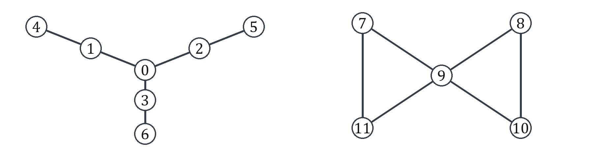

# Cotas óptimas para absorbedores de orejas dobles por triángulos de tipos prescritos

Juan Pablo Traverso Gianini  
Investigador independiente, Santiago, Chile  
ORCID 0009-0003-6068-4096

*Descomposiciones en triángulos · Nota de investigación que acompaña al artículo II*  
*Preprint 1.0 · 25 de noviembre de 2026 · Traducción del original inglés*

## Resumen

Estudiamos el grafo que se obtiene al añadir dos orejas a cada arista de un núcleo simple. Cada oreja une los extremos de su arista mediante un camino de longitud dos. La unión de estos caminos es el grafo que se debe absorber, y las aristas del núcleo quedan disponibles en el grafo ambiente. Cuando cada triángulo de la descomposición debe tocar ambas clases de una bipartición, todo absorbedor tiene al menos seis aristas por arista del núcleo. Caracterizamos la igualdad mediante una asignación de vértices auxiliares a las aristas del núcleo, permutaciones locales de esas asignaciones y una descomposición del grafo auxiliar en triángulos mixtos. Para dos etiquetados de un mismo camino de tres aristas, los tamaños mínimos son 18 y 21. Una garra subdividida alcanza 36. Al identificar los centros de varias copias se obtiene una familia infinita que alcanza la cota y cuyas aristas del núcleo no admiten una partición en ternas conexas. Si se prohíbe al absorbedor usar aristas entre centros, la cota inferior aumenta a doce aristas por arista del núcleo.

## 1. Planteamiento

Sea $C$ el conjunto de aristas de un grafo simple cuyos vértices llamaremos centrales, y sea $m=|C|$. Para cada $e=uv\in C$ introducimos dos vértices nuevos, las orejas de $e$. Cada oreja es adyacente a $u$ y a $v$. Sea $P$ la unión, sobre las aristas del núcleo, de las cuatro aristas que unen sus extremos a sus orejas. Llamaremos a $P$ el grafo fuente. Así, $|P|=4m$. El grafo ambiente $H$ induce exactamente $C\cup P$ sobre los centros y las orejas. Los demás vértices son auxiliares y las aristas incidentes con ellos pueden ser arbitrarias. Para un etiquetado $p\colon V(H)\to\{0,1\}$, un triángulo es *mixto* si en él aparecen ambas etiquetas.

Un absorbedor es un conjunto de aristas $A\subseteq E(H)\setminus P$ tal que tanto $A$ como $A\cup P$ admiten una descomposición en triángulos mixtos. Llamaremos a estas descomposiciones modo negativo y modo positivo, respectivamente. Así, el mismo conjunto de aristas de reserva puede absorber $P$ o descomponerse por sí solo [1]. Usamos la familia de tipos mixtos del artículo II [2]. Damos una cota inferior para el número de aristas de reserva y caracterizamos cuándo bastan seis aristas de reserva por arista del núcleo. El apéndice A recoge los enunciados formalizados en Lean.

## 2. La cota inferior y el caso de igualdad

**Teorema 1.** Todo absorbedor satisface

$$
|A|\ge 12m-6|A\cap C|\ge 6m.
$$

Existe un absorbedor de tamaño $6m$ si y solo si es posible hacer las siguientes elecciones en $H$.

1. Para cada $e=uv\in C$ se elige un vértice auxiliar $c_e$ tal que $uvc_e$ sea un triángulo mixto. En cada vértice central $u$, los vértices $c_e$ correspondientes a $e\ni u$ son distintos dos a dos.
2. En cada vértice central $u$ se permutan esos auxiliares entre las aristas incidentes con $u$. Denotamos por $x_{u,e}$ el vértice asignado a $e$ por esta permutación.
3. Para cada $e=uv$ se designa una oreja $a_e$ como *intacta* y la otra $b_e$ como *dividida*, de modo que $uva_e$, $ub_ex_{u,e}$, $vb_ex_{v,e}$ y $b_ex_{u,e}x_{v,e}$ sean triángulos mixtos de $H$.
4. Los pares $x_{u,e}x_{v,e}$, indexados por $e=uv\in C$, son distintos y su conjunto de aristas admite una descomposición en triángulos mixtos.

*Demostración.* Asignamos cargas a las aristas según las funciones de sus extremos. Usaremos $s=1$ para obtener la cota y $s=2$ para identificar el caso de igualdad.

| Extremos de la arista | Modo positivo | Modo negativo |
|:--|--:|--:|
| Centro y oreja | $7s+1$ | $0$ |
| Dos centros | $-8s-2$ | $-2$ |
| Centro y auxiliar | $-1$ | $1$ |
| Oreja y auxiliar | $-s$ | $s$ |
| Dos auxiliares | $2s$ | $-2s$ |

Escribimos $\mathsf C,\mathsf E,\mathsf X$ para las tres funciones de los vértices. Dos orejas nunca son adyacentes. En el modo negativo tampoco pueden ser adyacentes un centro y una oreja, pues todas esas aristas pertenecen a $P$. La tabla recoge la suma de las tres cargas de cada triángulo. Un guion indica un tipo imposible.

| Funciones de los vértices | Carga positiva | Carga negativa |
|:--|--:|--:|
| $\mathsf{CCC}$ | $-24s-6$ | $-6$ |
| $\mathsf{CCE}$ | $6s$ | — |
| $\mathsf{CCX}$ | $-8s-4$ | $0$ |
| $\mathsf{CEX}$ | $6s$ | — |
| $\mathsf{CXX}$ | $2s-2$ | $2-2s$ |
| $\mathsf{EXX}$ | $0$ | $0$ |
| $\mathsf{XXX}$ | $6s$ | $-6s$ |

Por ejemplo, un triángulo positivo de tipo $\mathsf{CCE}$ tiene una arista del núcleo y dos de la fuente, con carga total $(-8s-2)+2(7s+1)=6s$. Para ambos valores de $s$, la carga positiva de cada triángulo es a lo sumo $6s$ y su carga negativa es a lo sumo cero. Cada triángulo de una descomposición cubre exactamente tres aristas. Por tanto, la contribución del modo positivo es a lo sumo $6s(|A|+|P|)/3$ y la del negativo es a lo sumo cero. Al sumar las cargas de ambos modos, las aristas comunes se cancelan salvo las del núcleo. Al añadir la carga de la fuente obtenemos

$$
2s(|A|+|P|)\ge (7s+1)|P|-(8s+4)|A\cap C|.
$$

Para $s=1$ resulta $2|A|\ge 6|P|-12|A\cap C|$. Sustituyendo $|P|=4m$ y usando $|A\cap C|\le m$ se obtienen las dos desigualdades del teorema.

Si $|A|=6m$, la cota obliga a que todas las aristas del núcleo pertenezcan a $A$. Para $s=2$, ambos miembros de la desigualdad de cargas valen $40m$. Bastaría un solo triángulo con carga inferior a su máximo para que la desigualdad fuera estricta al sumar. Por tanto, cada triángulo positivo tiene carga 12 y cada triángulo negativo, carga cero. Cada arista del núcleo pertenece entonces a un triángulo negativo de tipo $\mathsf{CCX}$, que determina $c_e$. En un mismo centro, dos de estos triángulos con el mismo auxiliar compartirían una arista. El modo positivo usa cada arista del núcleo en un triángulo de tipo $\mathsf{CCE}$. Su oreja pertenece necesariamente a esa arista, pues sus únicos vecinos centrales son los dos extremos prescritos. Es la oreja intacta $a_e$. Las dos aristas de la fuente que pasan por la oreja dividida $b_e$ ya no pueden usar esa arista del núcleo. Por ello aparecen en triángulos de tipo $\mathsf{CEX}$. En cada centro, los vecinos auxiliares que aparecen en dichos triángulos son distintos y forman el mismo conjunto que en el modo negativo: en ambos casos son los vecinos auxiliares del centro en $A$. Se obtiene así la permutación local.

En $b_e$ el modo positivo proporciona exactamente dos aristas hacia auxiliares, una por cada extremo de $e$. Sus extremos auxiliares son distintos, pues de otro modo los dos triángulos compartirían una arista. Ambas aristas pertenecen a $A$. El único tipo negativo de carga máxima que contiene una oreja es $\mathsf{EXX}$, de modo que la descomposición negativa debe reunirlas en el triángulo $b_ex_{u,e}x_{v,e}$. Distintas orejas divididas dan distintas aristas auxiliares porque los triángulos negativos son disjuntos en aristas. A su vez, toda arista auxiliar del modo negativo pertenece a uno de estos triángulos, y en el modo positivo toda arista auxiliar pertenece a un triángulo de tipo $\mathsf{XXX}$. Queda probada la condición 4.

Recíprocamente, formamos $A$ con las aristas del núcleo, las $2m$ aristas de los centros a sus auxiliares asignados, las $2m$ aristas de las orejas divididas a sus auxiliares y las $m$ aristas auxiliares de la condición 4. Estas cuatro clases son disjuntas. Los triángulos $uvc_e$ y $b_ex_{u,e}x_{v,e}$ forman una partición de $A$ en aristas. En el modo positivo usamos $uva_e$, $ub_ex_{u,e}$, $vb_ex_{v,e}$ y la descomposición de la condición 4. Por las permutaciones locales, estos triángulos usan exactamente las mismas aristas entre centros y auxiliares que el modo negativo. Sus demás aristas cubren $P$ y las otras clases de $A$ exactamente una vez. $\square$

La igualdad implica $3\mid m$, pues el grafo auxiliar tiene $m$ aristas y se descompone en triángulos. Si los centros pertenecen a un conjunto protegido $Z$ y $A$ no contiene aristas con ambos extremos en $Z$, ninguna arista del núcleo puede pertenecer a $A$. En consecuencia, $|A|\ge12m$.

## 3. Un mismo núcleo con mínimos distintos

En cada ejemplo finito, el grafo ambiente contiene las aristas del núcleo y de la fuente, junto con todas las aristas simples incidentes con algún vértice auxiliar.

En el primer etiquetado, los vértices del camino $0,1,2,3$ tienen etiquetas $1,0,0,1$. Los vértices auxiliares $4,5,6$ tienen etiquetas $0,1,0$. Las dos orejas de $01$ tienen etiqueta cero, las de $12$ tienen etiqueta uno y las de $23$ tienen etiqueta cero. Cada fila da $c_e$ y el par ordenado de auxiliares que corresponden a los extremos de la oreja dividida.

| Arista del núcleo | $c_e$ | $(x_{u,e},x_{v,e})$ |
|:--|--:|:--|
| $01$ | 4 | $(4,5)$ |
| $12$ | 5 | $(4,6)$ |
| $23$ | 6 | $(5,6)$ |

En el centro $1$, las asignaciones $4,5$ de las aristas $01,12$ aparecen en el orden inverso en las dos orejas divididas. En el centro $2$ se intercambian del mismo modo $5,6$, mientras que cada hoja conserva su única asignación. Los pares auxiliares son las tres aristas del triángulo mixto $456$. Al sustituir las etiquetas en cada fila se comprueba la condición 3. El mínimo es 18. Para trabajar en el mismo grafo ambiente sin etiquetar que en el ejemplo siguiente, basta añadir un cuarto auxiliar de cualquiera de las dos etiquetas. Tanto la cota como la construcción de 18 aristas siguen siendo válidas.

En el segundo etiquetado los centros tienen etiquetas $0,0,1,0$. Las orejas de $01$ y $12$ tienen etiqueta uno, y las de $23$ tienen etiqueta cero. Supongamos que existe un absorbedor de 18 aristas y sea $w=c_{23}$. En la hoja $3$ la única arista hacia un auxiliar llega a $w$. El triángulo positivo de esa arista usa la oreja dividida de $23$. Como la hoja $3$ y esa oreja tienen etiqueta cero, para que el triángulo sea mixto debe cumplirse $p(w)=1$. En el vértice $2$, el triángulo positivo sobre su arista hacia $w$ no puede usar esa misma oreja, pues se repetiría la arista de la oreja a $w$. Debe usar la oreja dividida de $12$. Tanto esa oreja como el vértice $2$ tienen etiqueta uno, lo que obliga a $p(w)=0$. Queda descartado el tamaño 18. Dado que $A$ se descompone en triángulos, debe tener al menos 21 aristas.

Para alcanzar 21, numeramos las dos orejas de $01,12,23$ por $(4,5),(6,7),(8,9)$, respectivamente. Los auxiliares $10,11,12,13$ tienen etiquetas $0,0,1,1$. El modo negativo consta de las ternas mixtas

$$
(0,1,12), (1,2,10), (2,3,11), (3,12,13), (5,10,12), (7,11,12), (9,10,13).
$$

Estas siete ternas tienen conjuntos de aristas disjuntos y dan un conjunto $A$ de 21 aristas disjunto de $P$. Para el modo positivo usamos

$$
\begin{gathered}
(0,1,4), (0,5,12), (1,2,6), (1,5,10), (1,7,12), (2,3,8),\\
(2,7,11), (2,9,10), (3,9,13), (3,11,12), (10,12,13).
\end{gathered}
$$

Los pares de orejas $(4,5),(6,7),(8,9)$ dan cuenta de las doce aristas de la fuente. Por ejemplo, la terna $(0,1,4)$ cubre ambas aristas de la fuente en la oreja $4$, mientras que $(0,5,12)$ y $(1,5,10)$ cubren por separado las dos aristas en la oreja $5$. En la lista, cada arista restante pertenece a $A$ y ningún par se repite. Las once ternas cubren, por tanto, las $33=21+12$ aristas requeridas.

## 4. Una familia de núcleos acíclicos que alcanza la cota

El siguiente núcleo se obtiene subdividiendo una vez cada arista de una garra. Su centro es $0$, sus vértices intermedios son $1,2,3$ y sus hojas son $4,5,6$. En este orden, los siete vértices tienen etiquetas $0,0,0,1,1,1,0$. Los auxiliares $7,8,9,10,11$ tienen etiquetas $1,1,0,0,0$. La figura 1 muestra los dos grafos cuyas aristas figuran en la primera y la tercera columna de la tabla.

{width=82%}

| Arista del núcleo | $c_e$ | $(x_{u,e},x_{v,e})$ | $p(a_e)$ | $p(b_e)$ |
|:--|--:|:--|--:|--:|
| $01$ | 7 | $(8,9)$ | 1 | 1 |
| $14$ | 9 | $(7,9)$ | 1 | 0 |
| $02$ | 8 | $(9,10)$ | 1 | 1 |
| $25$ | 10 | $(8,10)$ | 1 | 0 |
| $03$ | 9 | $(7,11)$ | 1 | 0 |
| $36$ | 11 | $(9,11)$ | 0 | 1 |

Las aristas auxiliares se descomponen en los triángulos mixtos $7,9,11$ y $8,9,10$, que solo comparten el vértice $9$. En el centro $0$, por ejemplo, las asignaciones $7,8,9$ reaparecen como $8,9,7$. En el vértice $1$ se intercambian las asignaciones $7,9$, al igual que las dos asignaciones de cada uno de los vértices $2$ y $3$. Cada hoja conserva la suya. Las dos últimas columnas dan triángulos mixtos en las seis filas. Por el teorema 1, el mínimo es $6\cdot6=36$.

Para cada $k\ge1$ tomamos $k$ copias de esta construcción e identificamos sus centros $0$, con orejas y auxiliares distintos en cada copia. En cada modo, las descomposiciones de copias diferentes son disjuntas en aristas y coinciden en la etiqueta del centro común. Su unión da un absorbedor de tamaño $36k$, que alcanza la cota inferior para la estrella subdividida de $3k$ ramas. Las aristas del núcleo no admiten una partición en ternas conexas. En el grafo línea, cada arista exterior solo es adyacente a la arista interior de su rama. Una terna conexa contiene, por tanto, a lo sumo una arista exterior. Una partición de las $6k$ aristas constaría de $2k$ ternas y cubriría a lo sumo $2k$ aristas exteriores, menos que las $3k$ que hay para todo $k\ge1$.

## Agradecimientos

El autor agradece profundamente a su esposa María Paz y a sus hijos Lucas, Juan Cristóbal, Francisca, Raimundo y Benjamín su amor, paciencia y apoyo. Agradece a las comunidades de Lean y Mathlib la infraestructura utilizada en la formalización.

## Uso de inteligencia artificial y herramientas computacionales

Se utilizó ChatGPT/Codex, de OpenAI, para explorar y comprobar argumentos, desarrollar las pruebas en Lean y preparar el manuscrito y la figura. Los cálculos permitieron comprobar las construcciones finitas. La demostración de la cota inferior universal se da en la sección 2. El autor asume la responsabilidad por los argumentos, las citas, el código y la presentación. Ningún sistema de IA figura como autor.

## Referencias

[1] B. Barber, S. Glock, D. Kühn, A. Lo, R. Montgomery and D. Osthus, *Minimalist designs*, Random Structures & Algorithms **57** (2020), 47–63. <https://arxiv.org/abs/1808.06956>.

[2] J. P. Traverso Gianini, *Triangle decompositions II: Robust absorption for typed triangles*, preprint 1.0 (2026). <https://doi.org/10.5281/zenodo.23502224>.

## Apéndice A. Formalización en Lean

La formalización usa el predicado `IsAbsorber` del artículo II. Este exige que $A$ y $P$ sean disjuntos y que tanto $A$ como $A\cup P$ admitan descomposiciones en triángulos mixtos. La partición en dos etiquetas es independiente de la división de los vértices según sus tres funciones. En la tabla, los nombres de las declaraciones son relativos a `PartitionedTriangleAbsorption.SignedCertificate`.

| Espacio de nombres | Declaración | Conclusión |
|:--|:--|:--|
| DoubledEarEquality | `core_sensitive_bound` | Cota inferior del teorema 1 |
| DoubledEarEquality | `protected_centres_bound` | Cota con centros protegidos |
| DoubledEarEquality | `optimum_iff_routing_modes` | Igualdad en términos de incidencias |
| DoubledEarEquality | `twoMode_of_routing_modes` | Transferencia a los dos modos |
| TriangleFreeCore | `minimum_path_absorber` | Mínimo 18 |
| LabelledPathMinimum | `minimum_labelled_path_absorber` | Mínimo 21 |
| SubdividedClawMinimum | `minimum_subdivided_claw_absorber` | Mínimo 36 |
| SubdividedClawMinimum | `no_connected_triple_partition` | Obstrucción para la garra subdividida |

**Alcance.** La cota inferior formal cuenta las aristas de $A$ cuyos dos extremos son centros. Bajo la hipótesis sobre el subgrafo inducido, estas aristas forman exactamente $A\cap C$. El teorema de igualdad supone que $P$ consta de aristas del grafo ambiente entre centros y orejas, que todas las aristas de ese tipo pertenecen a $P$, que todas las aristas entre centros pertenecen a $C$, que no hay aristas entre orejas y que $|P|=4|C|$. Su conclusión caracteriza la igualdad mediante dos familias de triángulos mixtos de los tipos prescritos, disjuntos en aristas dentro de cada familia, que cubren el mismo conjunto de aristas fuera de la fuente. El lema `spoke_mem_iff` identifica los vecinos auxiliares correspondientes en cada centro. Para las orejas dobles, la sección 2 deduce las permutaciones locales de estas incidencias. El teorema de transferencia requiere además un conjunto de retorno disjunto del grafo ambiente que admita una descomposición en triángulos mixtos. Para la familia de la sección 4, Lean verifica el núcleo de seis aristas, su óptimo y su obstrucción. La prueba para todo $k$ es la de identificación de centros y recuento de esa sección.

**Versión de las fuentes.** Las [demostraciones](https://github.com/jtraverso/typed-triangle-absorption/tree/c7bae66dfd66370138d2f1a6ecc51d3aa29ea8e4) corresponden a la revisión `c7bae66dfd66370138d2f1a6ecc51d3aa29ea8e4`. El [suplemento de las pruebas formales](https://github.com/jtraverso/nash-williams-triangle-decompositions-release/tree/doubled-ears-preprint-1.0-r2/series_notes/DOUBLED_EAR_ABSORBERS/preprint-1.0/formalization) contiene el archivo completo de las fuentes, las revisiones de las dependencias y las órdenes para reproducir las ocho comprobaciones.

**Verificación.** Comparator cotejó los ocho enunciados de la tabla y el núcleo predeterminado de Lean aceptó la solución. Para cada teorema, la consulta de axiomas devuelve `propext`, `Classical.choice` y `Quot.sound`. La comparación se ejecutó en Windows con el aislamiento y Nanoda desactivados. La configuración pública habilita Nanoda para repetir la verificación en Linux.
